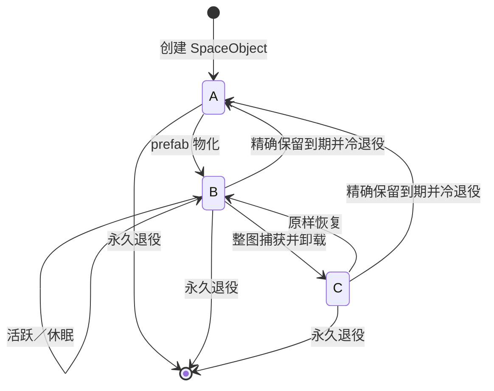

# 地图归档保留与退役

> 状态：已实现，1.6 离线回归通过；1.7 构建及两版游戏内新档验收见 [TODO](TODO.md)。本文是地图表示、精确保留、冷重建和永久退役的权威契约。

## 1. 目标

整图归档降低运行时地图数量，但 `ArchivedSpaceObject.mapData` 仍会进入游戏存档。若每个访问过的空间站都永久保存完整 Map，存档仍会随探索单调增长。因此近期现场使用原版整图精确保留，过期后在安全条件允许时退回可重建的轻量表示。

不实现通用地图差分。近期现场只认真实 Map 或其完整归档；过期现场从冻结 prefab 重建。

## 2. A／B／C 状态

| 状态 | 表示 | 权威结构事实 |
| --- | --- | --- |
| A：未物化 | 无图 `PoiState` | 冻结的 prefab 来源；从未生成和冷退役共用此表示 |
| B：已加载 | `MapSpaceObject` + Map | 真实 Map；休眠只是 B 的运行状态 |
| C：精确归档 | `ArchivedSpaceObject` | 完整 `mapData` 及卸载后无法重建的摘要 |
| 删除 | 不存在已注册对象 | 不是可恢复表示，不保存第二身份或墓碑 |

所有 A／B／C 替换都通过 `UniverseManager.ReplaceRepresentation`，继承同一 `SpaceObjectId`、绝对 `SpacePose` 和长期事实。延迟动作校验对象实例、表示版本和预期地图。

`SpaceMapStateManager` 是唯一状态机所有者：它管理物化、休眠、归档、恢复、冷退役、永久退役、保留记录和每对象唯一转移事务。任务、交易、NPC、地图池和 UI 只能发信号、提交意图或查询当次保护条件，不保存第二套生命周期状态。

## 3. Prefab 来源事实

每个可 prefab 重建的 `SpaceObject` 持久保存：

- `sourcePrefabPath`：相对 prefab 根目录的具体文件路径；
- `sourcePrefabCategoryPath`：生成表从根到叶的稳定节点 ID 序列，不使用显示名、列表顺序或文件夹名；
- `sourcePrefabSeed`：选择候选和局部朝向的稳定种子；
- `externalPrefabGenerationCompleted`：是否已成功完成一次外部 SpaceObject 标记展开。

这些字段由 `SpaceObject.CopyFactsTo` 随 A／B／C 传递，不放入 retention 旁表。首次星区生成、精确／cluster 标记子对象、任务敌舰和调试 prefab 替换均填写同一事实。

### 3.1 路径失效回退

A→B 在创建地图前只解析一次实际 prefab，尺寸和落位共用同一文档：

1. 具体路径有效时直接使用；
2. 否则从冻结分类路径最深仍存在节点收集有效 prefab；
3. 当前节点无候选时逐级退到父分类；
4. 整条路径失效时退到生成表全部有效 prefab；
5. 全局也无有效文件时保留原 A，退避后重试，不产生半成品 B。

候选按路径稳定排序后用 `sourcePrefabSeed` 确定性抽取。成功回退后，实际文件写回 `sourcePrefabPath`；原分类路径继续保留。玩家删除、移动、改 ID、导入／重置分类或修改 prefab 池时，设置界面明确警告既有 A 可能改用替代 prefab。显示名和密度变化不影响来源分类。

## 4. 外部 prefab 标记只展开一次

外部标记包括精确 SpaceObject 和 cluster SpaceObject 标记。人员标记不是外部标记。

A→B 时由 `SpaceMapStateManager` 执行单一批事务：

1. prefab 内容完整落位并完成设施重链；
2. 收集本批全部外部标记并生成子 A 计划；
3. 先解析全部唯一子 prefab；
4. 批量注册全部子对象，任一失败则注销本批已注册对象并保留标记；
5. 其他本地标记正常展开；
6. 全部成功后消费外部标记，并把宿主 `externalPrefabGenerationCompleted` 置为 true；没有外部标记也置 true；
7. 最后提交 A→B。失败时恢复原 A，并在安全帧销毁候选地图。

冷退役后的 A 已带 true。再次物化时只消费外部标记，不重新创建子对象；人员标记仍照常生成人员。因此永久删除子对象后，父 prefab 冷重建不会使其复活，不需要 marker UUID、来源 lineage 或退役墓碑。顶层星区对象仍由 `generatedSectorTiles` 防止重新刷出。

`clusterChild` 仅是作者错误导致 cluster 递归时的安全门，不承担长期身份。

## 5. 精确保留时钟

- 只使用游戏 tick；暂停不推进。
- 默认精确保留 60 游戏日。
- `MapRetentionRecord` 只保存首次物化 tick、最后有意义玩家接触 tick、手动精确保留和压缩大小。
- 保护条件只阻止当次退役，不自动续期。

会刷新接触时间的事实包括玩家 Pawn／船到场、对接、交易、任务、实际货物转移及玩家明确的长期保留。远程战斗只在玩家归因的基架确实被移除后发布 `StructureChange`；普通建筑扣血、未命中、NPC 战斗和被动物化不刷新。

## 6. 冷退役门禁

下列事实阻止冷退役或永久删除：

- 玩家 Pawn、收押人员、玩家船、玩家家园或玩家永久建筑；
- 活跃任务引用来源、目的地或敌舰；
- 当前／聚焦地图；
- 正在生成、恢复、转移、对接或等待版本化帧动作；
- 无法无损卸载的外部引用；
- 玩家手动要求长期精确保留。

普通地面物品、垃圾、尸体、战损、NPC 库存和 NPC 局部状态不是永久阻塞。一粒遗留物在保真期内原样存在，期限届满并成功冷退役后随旧现场消失。

冷退役事务先验证可用 prefab，再恢复必要的精确归档、复核门禁并走原版 Map 清理链。只有清理完成后才以同 ID 发布 A 并清除旧 `mapData`；失败保留精确表示。

## 7. 空间站任务端点

任务端点的长期地址是空间站 `SpaceObjectId`，不是终端实例。

- 同一空间站所有终端共用一个任务板；
- 可在同站任意终端接取、交付和领奖；
- 交互时使用当前终端绑定的本地货柜和白银；
- 不同 SpaceObject 的任务板互不共享；
- 需要当前建筑时，从目标 Map 确定性选择一台已生成终端，Thing 引用不持久化；
- 战斗目标仍可使用稳定船身份。

终端和 prefab marker 均没有 UUID。加载、导出、归档和冷重建不校验或保存终端实例身份。冷 A 仍保留 SpaceObject 和任务板；永久删除且无活跃合同的站点任务板在交互边界清理。

## 8. 永久退役

永久退役用于对象耗尽、摧毁、流程结算或玩家明确放弃。manager 清理 Map／parent／归档／缓存，注销对象并删除 retention 记录。不存在 `RetirementTombstone`；防重生分别由顶层星区生成记账和父对象的外部 prefab 一次性事实承担。

## 9. 玩家控制与验收

详情窗口显示 A／B／C、B 的休眠标记、A 的冷重建来源、最后接触、预计到期、归档大小和阻塞原因。玩家可切换长期精确保留、请求立即冷重建或永久放弃；硬阻塞时拒绝执行。

离线回归覆盖身份与来源事实传递、状态派生、正式 prefab 无 UUID、任务端点序列化和基础资源重建。以下仍需两版新档游戏内验收：真实 A→B→C→B／冷 A→B、冷重建人员、子对象不复活、同站多终端交付、长期连续访问后的存档体积，以及玩家远程破坏基架的接触时钟。
