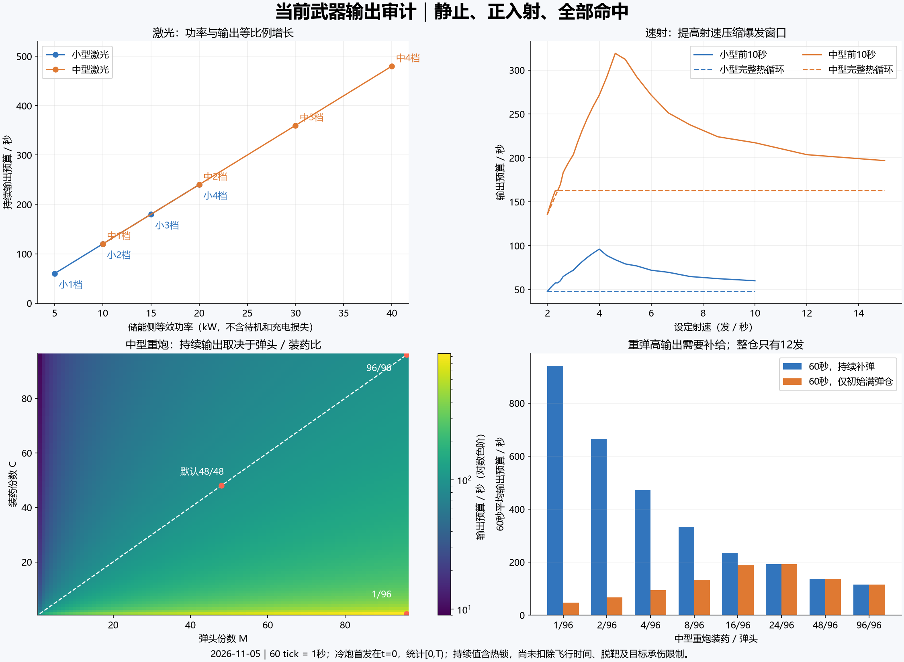

# 武器输出审计（2026-11-05）

本轮只审计，不调整武器、护盾或配方。现行规则仍以[武器基线](武器伤害与费效比基线.md)与[护盾基线](护盾机制基线.md)为准；本页保存此次量化结果、比较条件及调参判断。

30k 扩容与第二版长冷却方案均已撤回，见[纠错记录](护盾战斗时长参数方案.md)。本页仅保留现行输出测量；武器职责以[武器定位与克制关系](武器伤害与费效比基线.md#武器定位与克制关系2026-11-05-定案)为准，当前数字不能反过来定义正确定位。

**结论已校正：本页测量暴露的是当前数值与定位的偏差，不能据此断言三类武器不该削弱、守卫容量应增加，或低装药重弹已平衡。下一轮须先满足速射最高 DPS、激光中 DPS、重炮低 DPS，以及厚甲／三类护盾的克制分工；具体参数尚未确定。**



## 1. 证据与统计口径

审计入口是 `scripts/WeaponTuningRegression/run.ps1 -OutputAudit`。先执行现有 218 项回归，再扫描 **20,592 种配置**：激光两种尺寸各 4 档；速射小型 6～30 tick、中型 4～30 tick 的全部整数间隔，钢／铀两种弹头；重炮小型 1～32、中型 1～96 的全部装药×弹头组合，钢／铀各一份。另执行 **352 个守卫盾对照场景**。

审计直接调用刚构建的生产 DLL 中的 `CompWeaponTuning.CommitShot/AdvanceThermalTick`、`SpaceKinetics.LaunchSpeed`、`SpaceImpactEffects.ComputeDamage` 与 `CompSpaceShield.ConsumeGuard/AdvanceGuardTick`。不另写热锁、伤害或盾容算法。武器、弹体、后效、弹药配方及铀弹质量读取真实 XML；复用现有护盾回归夹具隔离地图／供电副作用，夹具提供已加载、持续通电、标准满常规与可选满应急的发生器，显式传入共享成员。

完整参数结果、盾场景和 DLL／Def SHA256 写入忽略目录 `Source/obj/WeaponTuningRegression/output-audit.json`，可重新生成。本页与图是本次结果快照。

共同前提：

- **60 tick = 1 秒模拟时间**；不按真实墙钟或游戏倍速计算。冷炮、可立即开火，第一发在 t=0；10／60 秒统计区间为 `[0,T)`，不包含恰好落在终点的下一发。
- 双方静止、正入射、每发命中，无中途碰盾／碰建筑损耗。输出是**毁伤预算**，不是实际舰体扣血或击毁数。真实命中率、装甲／建筑剩余耐久、掩体、盾面角度、激光不续穿、炮手与射界均会改变结果。
- “瞬时 DPS”按设定间隔算，不包含后续热锁；“持续 DPS”按完整冷炮→过热→完全冷却循环精确计数；“前 10／60 秒”包含启动时的冷炮优势。因此短窗平均可能高于长期值。
- 除“仅初始弹仓”外，假设弹药持续补充；激光默认假设逐发电量充足。有限弹仓场景禁止重装和材质回退，钢弹使用宿主满仓，铀弹使用一件满铀弹仓。
- 盾时间从**第一发抵达盾面**开始，保留相邻命中的发射间隔，不含距离造成的飞行延迟。不模拟转向、相对运动、规避或真实射线求交。
- 电量为 RimWorld 的 W·d。原版 `CompPower.WattsToWattDaysPerTick = 1/60000`，因此每模拟秒消耗 1 W·d 对应储能侧 1000 W。表中不是配电系统所需的精确发电机功率：待机另计，普通电池的充电效率、线路其他负载及储能门禁还会增加需求。专用电容使用现有独立充电机制。

## 2. 激光：高功率确实换来高输出，也等比例消耗储能

两种尺寸均为 12 tick／束，即 5 束／秒；无热锁，前 10 秒、前 60 秒及长期 DPS 相同。

| 尺寸／功率档 | 单束预算 | 单束 W·d | 持续 DPS | 储能侧等效功率 | 60 秒耗能 W·d |
| --- | ---: | ---: | ---: | ---: | ---: |
| 小型 1 | 12 | 1 | 60 | 5000 W | 300 |
| 小型 2 | 24 | 2 | 120 | 10000 W | 600 |
| 小型 3 | 36 | 3 | 180 | 15000 W | 900 |
| 小型 4 | 48 | 4 | 240 | 20000 W | 1200 |
| 中型 1 | 24 | 2 | 120 | 10000 W | 600 |
| 中型 2 | 48 | 4 | 240 | 20000 W | 1200 |
| 中型 3 | 72 | 6 | 360 | 30000 W | 1800 |
| 中型 4 | 96 | 8 | 480 | 40000 W | 2400 |

待机另加小型 60 W／中型 160 W。所有档位正入射均为 **12 预算／W·d**，不存在升档带来的能效红利；升档的收益是更快集中火力、提高每束伤害。它没有实弹飞行等待，代价是储能、供电和电磁盾克制，且击毁首个建筑后不能沿剩余预算续穿。

一件激光电容储量 600 W·d、充电功率 1800 W，从空到满约 333.33 模拟秒（8 游戏小时）。单靠该充电通道，储能用尽后的长期输入上限仅为 **21.6 预算／秒／电容**，与所选功率档无关；实际脉冲门禁、其他负载可能使其更低。中型双电容的对应上限为 43.2。允许从电网电池取电时，不受这个“仅电容充电”的上限约束，但消耗转移到电网储备。

满电后不计战中回充，一件电容可支付中型最高档 75 束，覆盖 15 秒的发射窗口；两件可支付 150 束，覆盖 30 秒。实际槽位还要与自瞄取舍。不能把“峰值 480 DPS”理解为几千瓦电网就能永久维持；也不能仅因需要储能就忽略它在几十秒交战中的强度。

**判断：没有足够证据普遍削激光。若实战显得过强，应先区分使用满电容的首轮爆发与长时间发电补给；同能耗下，小／中型的基础能效一致。**

## 3. 速射：射速主要改变爆发窗口

钢弹小型单发 24，中型单发约 67.88。以下覆盖代表档；完整 52 个射速设置及铀弹结果见 JSON。过热时间为冷炮开始到触发热锁的命中／发射时间。

| 尺寸／间隔 tick | 设定发／秒 | 瞬时 DPS | 首次过热秒 | 前 10 秒 DPS | 持续 DPS | 前 60 秒 DPS | 仅初始弹仓的 60 秒 DPS |
| --- | ---: | ---: | ---: | ---: | ---: | ---: | ---: |
| 小型 6 | 10 | 240 | 2.40 | 60 | 48 | 50 | 50 |
| 小型 12（默认） | 5 | 120 | 6.40 | 79.2 | 48 | 52.8 | 52.8 |
| 小型 15 | 4 | 96 | 9.75 | 96 | 48 | 48 | 48 |
| 小型 20 | 3 | 72 | 19.33 | 72 | 48 | 48.4 | 48.4 |
| 小型 30 | 2 | 48 | 不过热 | 48 | 48 | 48 | 48 |
| 中型 4 | 15 | 1018.23 | 1.87 | 196.86 | 162.92 | 164.05 | 164.05 |
| 中型 6 | 10 | 678.82 | 3.10 | 217.22 | 162.92 | 181.02 | 169.71 |
| 中型 10（默认） | 6 | 407.29 | 6.50 | 271.53 | 162.92 | 181.02 | 169.71 |
| 中型 12 | 5 | 339.41 | 9.00 | 312.26 | 162.92 | 170.84 | 169.71 |
| 中型 13 | 4.62 | 313.30 | 10.40 | 319.05 | 162.92 | 166.31 | 166.31 |
| 中型 20 | 3 | 203.65 | 38.67 | 203.65 | 162.92 | 170.84 | 169.71 |
| 中型 25 | 2.4 | 162.92 | 不过热 | 162.92 | 162.92 | 162.92 | 162.92 |
| 中型 30 | 2 | 135.76 | 不过热 | 135.76 | 135.76 | 135.76 | 135.76 |

持续热平衡射速小型 2、中型 2.4 发／秒。小型所有可调档长期均为 48；中型 4～25 tick 长期均为约 162.92，26～30 tick 则因设定射速低于热平衡上限而下降。满速中型的 1018.23 仅是不到两秒的爆发，不能与重炮含冷却的长期输出直接比较。

前 10 秒输出最高的小型为 15 tick，中型为 13 tick；这是**固定统计窗口**的结果，不是普适最佳档。短于两秒的破盾机会、等待齐射、敌人即将进入遮挡等场景仍可能偏好最高射速。

小型钢弹每发 0.2 钢铁、长期 0.4 钢铁／秒；中型每发 0.6、热平衡时 1.44 钢铁／秒。中型装药满仓只能支持 150 发，因此默认前 60 秒不限补给时为 160 发、10861.16 预算，禁止重装时为 150 发、10182.34 预算。两型待机同样为 60／160 W，无逐发电费。

**判断：速射没有“调到最高射速就同时获得最高长期输出”的失衡。现有热锁已约束持续输出；是否削减首轮爆发，应按实际目标的暴露窗口和破盾时间决定。**

## 4. 重炮：装药／弹重改变的是不同维度

对钢弹，C 为装药、M 为弹头数量，当前共同公式可化简为：

```text
弹速 v = 60 × sqrt(C/M)
单发预算 D = 24 × sqrt(CM)
小型周期 T = C/3 秒；持续 DPS = 72 × sqrt(M/C)
中型周期 T = C/4 秒；持续 DPS = 96 × sqrt(M/C)
每发材料 = (C+M)/10 钢铁
```

这些周期在实际逐 tick 组件中得到验证。小／中型的每单位装药分别恰好对应 20／15 tick，没有机械周期下限。

### 4.1 默认、等比例升档与偏置组合

| 尺寸 C／M | 弹速 格／秒 | 单发预算 | 周期秒 | 持续 DPS | 前 10 秒 DPS | 前 60 秒 DPS | 长期钢铁／秒 |
| --- | ---: | ---: | ---: | ---: | ---: | ---: | ---: |
| 小型 1／1 | 60 | 24 | 0.33 | 72 | 72 | 72 | 0.6 |
| 小型 24／24（默认） | 60 | 576 | 8 | 72 | 115.2 | 76.8 | 0.6 |
| 小型 32／32 | 60 | 768 | 10.67 | 72 | 76.8 | 76.8 | 0.6 |
| 中型 1／1 | 60 | 24 | 0.25 | 96 | 96 | 96 | 0.8 |
| 中型 48／48（默认） | 60 | 1152 | 12 | 96 | 115.2 | 96 | 0.8 |
| 中型 96／96 | 60 | 2304 | 24 | 96 | 230.4 | 115.2 | 0.8 |
| 中型 96／24 | 120 | 1152 | 24 | 48 | 115.2 | 57.6 | 0.5 |
| 中型 24／96 | 30 | 1152 | 6 | 192 | 230.4 | 192 | 2.0 |
| 中型 8／96 | 17.32 | 665.11 | 2 | 332.55 | 332.55 | 332.55 | 5.2 |
| 中型 4／96 | 12.25 | 470.30 | 1 | 470.30 | 470.30 | 470.30 | 10.0 |
| 中型 1／96 | 6.12 | 235.15 | 0.25 | 940.60 | 940.60 | 940.60 | 38.8 |

可见：

1. **C=M 时升档不增加持续输出。** 它将多发预算集中为更大的单发，用更长停火换深穿／重击。中型从 48／48 到 96／96，单发翻倍，周期也翻倍，长期仍为 96。
2. **固定弹头增加装药**：提高弹速及单发，却降低长期输出。相同 1152 单发可由 96／24、48／48、24／96 获得，弹速分别 120／60／30，长期分别 48／96／192。这是非常强的命中率与吞吐量取舍。
3. **固定装药增加弹头**：提升单发和长期输出，不增加热量，但降低弹速并增加物料。这是当前最值得专项验证的参数方向。
4. 小型 1／1 重炮的长期 72 高于小型速射 48；中型对应 96 低于中型速射 162.92。前者是与“速射最高 DPS、重炮低 DPS”定位冲突的现行数值证据，不能用短时射速、材料或硬件差异直接解释为设计正确。

### 4.2 有限弹仓会大幅改变低装药重弹结果

中型宿主钢弹头满仓 1200；M=96 时只有 **12 发**。这张表不补弹、无材质回退，时间从发射开始计，仍假设命中。

| C／M | 最后一发时刻秒 | 整仓预算 | 前 60 秒 DPS：补弹充足 | 前 60 秒 DPS：不补弹 |
| --- | ---: | ---: | ---: | ---: |
| 1／96 | 2.75 | 2821.81 | 940.60 | 47.03 |
| 2／96 | 5.50 | 3990.64 | 665.11 | 66.51 |
| 4／96 | 11 | 5643.62 | 470.30 | 94.06 |
| 8／96 | 22 | 7981.29 | 332.55 | 133.02 |
| 16／96 | 44 | 11287.25 | 235.15 | 188.12 |
| 24／96 | 66 | 13824 | 192 | 192 |
| 48／96 | 132 | 19550.09 | 135.76 | 135.76 |
| 96／96 | 264 | 27648 | 115.2 | 115.2 |

**1／96 的一整仓甚至不足以打穿 3000 满盾**，尽管无限补给时只需 13 发、从首发抵达算 3 秒就能耗尽该盾。在不停补弹的假设下，它每分钟需要 2328 钢铁折合物料；默认 48／48 只需 48 钢铁／分钟。

钢弹单位物料效率为 `240×sqrt(CM)/(C+M)`，C=M 时最高为 120 预算／钢铁；1／96 仅约 24.24。高吞吐量重弹同时牺牲了物料效率，不能把材料无限当作通常战况。

### 4.3 飞行时间与寿命

常规实弹寿命配置为 900 tick，近似 15 秒；运行时在超过寿命后清除，端点存在 tick 级误差。静止条件下的寿命航程近似 `15v`，与炮塔设定的瞄准射程是两个限制。

- 中型 1／96：约 6.12 格／秒，寿命航程约 **91.86 格**，抵达 50 格约需 **8.16 秒**。即使炮塔能瞄准更远目标，这发也无法在静止条件下抵达 150 格。
- 中型 4／96：约 12.25 格／秒，寿命航程约 183.71 格；抵达 150 格需 12.25 秒，给对方充分的移动时间。
- 中型 48／48：60 格／秒，抵达 150 格约 2.5 秒。

全网格还筛选了“满足静止寿命航程与自动瞄准射程”的持续 DPS 最大值：中型在 50／100／150／200 格分别为 1／96（940.60）、1／80（858.65）、2／71（571.99）、1／20（429.33）。这些只是**理想静止靶的数学上界**，后面三者接近寿命极限，不包含目标移动、曲面几何或炮口偏移，不能用作实战推荐配装。相对运动还会同时改变接近速度和毁伤。

### 4.4 铀弹

同 C、M 下，质量为钢弹的 1.5 倍，化学发射初速变为约 0.8165 倍，正入射预算和长期 DPS 为约 **1.2247 倍**；不是 1.5 倍伤害。舰体穿深由这份预算逐层消耗决定；额外的材质 AP 系数作用于原版护甲判定，不额外增加建筑贯穿预算或盾耗。

例如中型 48／48 铀弹单发约 1410.91、持续约 117.58；96／96 单发约 2821.81，双方静止时仍低于 3000 完整守卫容量。代价是弹速与寿命航程降低、占用插件槽、消耗铀；一件铀弹仓容量 600，M=96 只有 6 发。审计禁止铀仓用尽后回退钢弹，以单独比较该配置；游戏实际允许按优先级回退。

**判断已校正：低装药重弹的高理论 DPS 是需要按重炮低 DPS 定位复核的偏差；命中与后勤是独立约束，不能据它们直接认定该收益合理。公式或热参数如何调整尚未确定，不恢复机械下限，也不沿用已撤回的低速衰减提案。**

## 5. 与守卫盾对照

按当前默认 100% 恢复入池阈值，常规耗尽后等待 10 秒，再通电恢复约 41.67 秒。下表包含真实恢复与共享扣除，假设无白银补充、攻击方弹药／电量充足、持续命中。三台方案只有前方盾面参与碰撞，后两台贡献常规池，因此前方可用初始容量为 **3000 共享常规＋2000 本地应急**，不是 9000。

“盾面失效”指命中后前方圆盾容量归零的首次时刻；可贯穿实弹可能在该发继续攻击船体，激光该束仍被截停，下一束才可穿过缺口。不代表舰船在该时刻必定被摧毁。

| 攻击配置 | 单台常规首次耗尽秒 | 单台满盾首次失效秒 | 三台共享前盾首次失效秒 |
| --- | ---: | ---: | ---: |
| 小型激光 1 档 | 16.6 | 49.8 | 83.2 |
| 中型激光 1 档 | 8.2 | 24.8 | 41.6 |
| 小型激光 4 档 | 4.0 | 12.4 | 20.8 |
| 中型激光 4 档 | 2.0 | 6.2 | 10.4 |
| 小型速射默认 | 18.1 | 54.7 | 101.2 |
| 中型速射默认 | 2.33 | 17.33 | 22.17 |
| 小型重炮 24／24 | 8 | 40 | 64 |
| 中型重炮 48／48 | 0（首发） | 24（第 3 发） | 48 |
| 中型重炮 96／96 | 0（首发） | 24（第 2 发） | 48 |

这组结果修正了只看单发容易产生的印象：**默认中型重炮并不是最快打穿完整守卫盾的常规武器**。默认中型速射更快，最高档中型激光快得多；重炮使常规盾首发见底，视觉与应急耗材体验尤其突出。

标准新建发生器的常规满容，应急原版燃料初始为空。新建后没有补银的“满常规盾”只有 1000；试验场 prefab 则显式装有 2000 应急，终端切换不补容。观察“一发破盾”前必须分清这两种状态。

常规恢复速度为每台 24／秒，但它不能在持续扣常规时正常回充；默认阈值还会把已恢复但未满的常规容量留在池外。例如默认中型重炮在 24 秒打空单台应急时，常规已恢复约 336，却尚未重新启用。缩短重返战斗的等待与扩大单发缓冲是两个不同目标，单调容量无法解释所有体感问题。

## 6. 定位约束与审计边界

本审计的输出数字保留；此前优先扩盾、重做统一热循环及第二版参数推荐均已撤回。后续以[武器定位与克制关系](武器伤害与费效比基线.md#武器定位与克制关系2026-11-05-定案)为准：常规武器应满足速射最高 DPS、激光中 DPS、重炮低 DPS，并分别履行破甲后拆基架／压盾、持续精准照射、厚甲突破职责；轨道炮负责战略开场破盾和深穿。

仅测守卫容量无法验证这些职责。需要加入厚甲、裸露基架、动能盾、电磁盾及其混合防御，分别记录单发击毁层数、贯通缺口时间、内部设备受损、基架毁伤、盾失效与反伤、常规／应急恢复及电能储备。舰体穿甲按既有穿深链评价，不用原版 AP 替代，也不另增装甲系统；具体口径见[武器基线](武器伤害与费效比基线.md#质量初速与共同毁伤)。当前激光高功率输出、低装药重炮输出和小型武器排序出现倒挂，是待标定项，不以补弹耗尽或缺电作为定位成立的证明。

激光没有过热，不新增热锁；速射和重炮比较真实热循环，但不强制所有档位都过热、不统一增加长冷却，也不要求全舰同步停火。2～4 分钟的整舰目标不能只用首个盾面失效时间替代，不能通过更换测试舰防御配比宣称达成。

调容量仍须检查 `regularCapacity / guardRecoveryTicks` 的回充联动、地表尺度与经济成本；不再据当前重炮单发高于盾容就直接推荐加盾。当前数值与设计偏差统一记录在武器基线，本文不另定一套参数目标。

## 7. 复现、检查与边界

```powershell
just build
powershell.exe -NoProfile -ExecutionPolicy Bypass -File scripts/WeaponTuningRegression/run.ps1 -OutputAudit
python scripts/WeaponTuningRegression/render_output_audit.py
```

渲染需 matplotlib。脚本先查本地忽略目录 `Source/obj/WeaponAuditPython`，也支持已安装在 Python 环境中的版本；Windows 使用微软雅黑，其他平台需提供可用中文字体。本轮使用 matplotlib 生成 PNG，并检查了输出图。

已完成：1.7 REF 与 Delta-V 构建零警告／零错误；原有 218 项武器／护盾检查通过；20592 配置、352 盾场景完成；全部配置与独立闭式伤害／热平衡公式、有限库存上界核对一致；材料口径核对实际 20→200 配方；电量单位核对 `_references/RimWorldDecompiled_1.7/Assembly-CSharp.cs` 的原版常量。旧 11-01 平衡计划中的 `(C+M)/20` 及部分材料消耗示例对应旧配方，本审计使用当前 `(C+M)/10`，不沿用旧经济数字。

未启动游戏、未修改运行时参数、未提交。此审计不覆盖游戏内 Harmony 全流程、真实搬运吞吐、炮手／火控调度、命中率、目标移动、线盾几何、电网短缺或舰体逐层毁伤。因此结论用于选下一轮参数对照，不能代替新档实弹验收。
